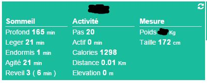

Sobald Sie das Fitbit-Plugin installiert haben, gehen Sie zu :

image::../images/fitbit-1.JPG[]

=== Erstellung eines Gerätes und Assoziation mit Fitbit-Konto

[TIP]
Wie an vielen Stellen in Jeedom kann mit dem Mauszeiger ganz links, ein Menü mit Schnellzugriff aufgerufen werden (Sie können in Ihrem Profil immer sichtbar einstellen).  

Klicken Sie auf "Person hinzufügen" um jemand hinzuzufügen : 

image::../images/fitbit-2.JPG[]

Geben Sie einen Namen für diese Person ein (dieses Gerät) und bestätigen sie : 

image::../images/fitbit-3.JPG[]

Sie haben dann diese Seite : 

image::../images/fitbit-4.JPG[]

[IMPORTANT]
Le premier truc à vérifier est "URL de retour". Celle-ci doit être validée et accessible de l'extérieure sinon vous ne pourrez pas associer Jeedom à votre compte Fitbit. Si ce n'est pas le cas, mettez à jour vos paramètres de configuration réseaux dans Général -> Administration -> Configuration puis partie "réseaux", voir https://www.jeedom.fr/doc/documentation/core/fr_FR/doc-core-administration.html.html#administration[ici]

[NOTE]
Il est recommandé lors du lien entre Jeedom et Fitbit d'etre connecté à Jeedom par l'ip externe

Cliquez sur "Lier à un utilisateur" pour lier cet équipement à votre compte Fitbit : 

image::../images/fitbit-5.JPG[]

Indiquez vos identifiants de votre compte Fitbit, puis validez la demande d'autorisation : 

Si vous obtenez une page blanche ou une erreur, c'est que votre configuration réseaux n'est pas bonne, sinon vous devez retomber sur cette page : 

image::../images/fitbit-6.JPG[]

=== Konfiguration

Voici les détails de la configuration du plugin : 

image::../images/fitbit-6.JPG[]

* Nom de la personne : nom de l'équipement Fitbit
* Objet parent : nom de l'objet auquel ratacher l'équipement
* Activer/Visible : permet d'activer l'équipement (ne pas oublier de le faire sinon vous n'aurez aucune donnée) et de le rendre visible sur le dashboard
* Für jeden Befehl : 
** Historiser : permet d'historiser la commande
** Afficher : permet de la rendre visible ou non sur le dashboard
** Avancée (petites roues crantées) : permet d'afficher la configuration avancée de la commande
** Tester : permet de tester la commande pour voir sa valeur
** Supprimer (bouton "-") : pour supprimer la commande

=== Widget

Hier ist das Fitbit-Widget :

