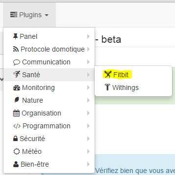
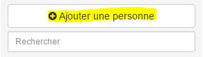
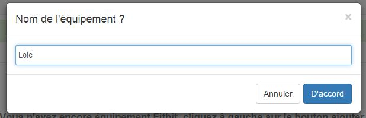
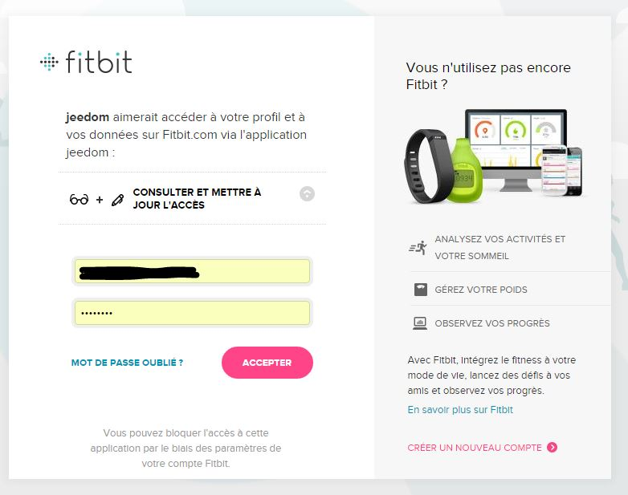

Une fois le plugin Fitbit installé aller sur :

==== Création d'un équipement et association au compte Fitbit

Cliquez sur ajouter une personne pour ajouter quelqu'un : 

Donnez un nom à cette personne (cet équipement) et validez : 

Vous devez ensuite avoir cette page : 

image::../images/fitbit-4.JPG[]

[icon="../images/plugin/important.png"]
[IMPORTANT]
Le premier truc a verifier est "URL de retour" celle-ci doit etre valide et accessible de l'exterieure sinon vous ne pourrez pas associer Jeedom a votre compte Fitbit. Si ce n'est pas le cas, mettez à jour vos parametre de configuration réseaux dans Générale -> Administration -> Configuration puis partie reseaux, voir link:http://doc.jeedom.fr/fr_FR/core.html#administration[ici]

Cliquez sur "Lier à un utilisateur" pour lier cet équipement à votre compte Fitbit : 

Indiquez vos identifiants de votre compte Fitbit, puis validez la demande d'autorisation : 

Si vous obtenez une page blanche ou une erreur c'est que votre configuration reseaux n'est pas bonne, sinon vous devez retomber sur cette page : 

image::../images/fitbit-6.JPG[]

==== Configuration

Voici les détails de la configuration du plugin : 

image::../images/fitbit-6.JPG[]

* Nom de la personne : nom de l'équipement Withings
* Objet parent : nom de l'objet auquel ratacher l'équipement
* Activer/Visible : permet d'activer l'équipement (ne pas oublier de le faire sinon vous n'aurez aucune données) et de le rendre visible sur le dashboard
* pour chaque commandes : 
** historiser : permet d'historiser la commande
** Afficher : permet de la rendre visible ou non sur le dashboard
** Avancée (petites roues crantés) : permet d'afficher la configuration avancée de la commande
** Tester : permet de tester la commande pour voir sa valeur
** Supprimer (bouton "-") : pour supprimer la commande
