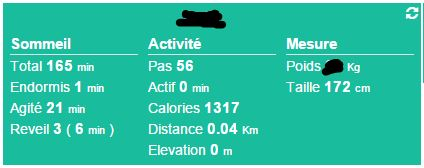

Konfiguration 
=============

 :

 
--------------------------------------------------------

> **Spitze**
>
> 
> ruft ein Schnellzugriffsmenü auf (Sie können
> 

 :

 :

 :

> **Wichtig**
>
> ". 
> 
> . 
> 
> 
> [ici](https:

> **Notiz**
>
> 
> 

[ici](https://dev.fitbit.com/fr), ensuite il vous faut vous connecter
 : "". 
:

-    : Jeedom

-   Beschreibung : Jeedom

-    : <https:>

-    : Jeedom

-    : <https:>

-   . : 

-    : 
    
    

-    : 

 :

-    : Ja

-    : 

-   Typ : 

-    : Setzen Sie nichts

 :

-   

-   

-   

-   

-   

> **Wichtig**
>
> 
> 

 :

 :

diese Seite :

Konfiguration 
-------------

 :

-    : 

-   Übergeordnetes Objekt : 

-    : 
    
    auf dem Armaturenbrett

-    :

    -   Chronik : 

    -   Anzeige : 

    -    : 
        

    -   Test : 

    -    : 

Widget 
------

 :

