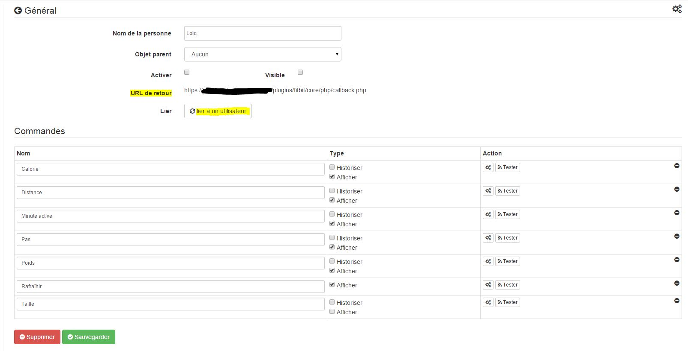
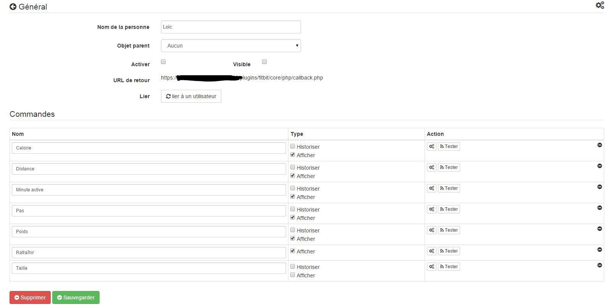
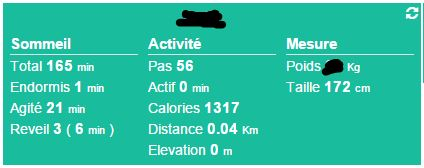

Setup 
=============

 :

 
--------------------------------------------------------

> **Tip**
>
> 
> brings up a quick access menu (you can
> 

 :

 :

 :

> **Important**
>
> ". 
> 
> . 
> 
> 
> [ici](https:

> **NOTE**
>
> 
> 

[ici](https://dev.fitbit.com/fr), ensuite il vous faut vous connecter
 : "". 
:

-    : Jeedom

-   Description : Jeedom

-    : <https:>

-    : Jeedom

-    : <https:>

-   . : 

-    : 
    
    

-    : 

 :

-    : Yes

-    : 

-   Type : 

-    : Put nothing

 :

-   

-   

-   

-   

-   

> **Important**
>
> 
> 

 :

 :

this page :

Setup 
-------------

 :

-    : 

-   Parent object : 

-    : 
    
    on Dashboard

-    :

    -   Historize : 

    -   Show : 

    -    : 
        

    -   Test : 

    -    : 

Widget 
------

 :

