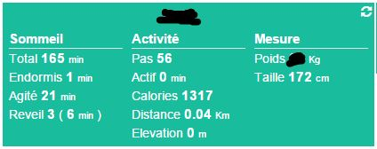

Complemento para acceder a información en dispositivos Fitbit
(número de pasos, calorías, distancia ...)

Configuración 
=============

Una vez que el complemento Fitbit esté instalado, ve a :

Creación de equipos y asociación con cuenta Fitbit 
--------------------------------------------------------

> **Tip**
>
> Como en muchos lugares de Jeedom, coloca el mouse en el extremo izquierdo
> abre un menú de acceso rápido (puedes
> de tus perfiles siempre lo dejas visible)

Haga clic en agregar una persona para agregar a alguien :

Dé un nombre a esta persona (este equipo) y valide :

Entonces deberías tener esta página :

> **Important**
>
> Lo primero que debe verificar es "URL de retorno". Esto debe ser
> validado y accesible desde el exterior, de lo contrario no podrá
> vincula Jeedom a tu cuenta de Fitbit. Si no, pon
> actualice la configuración de su red en General →
> Administración → Configuración y luego parte "redes", ver
> [aquí](https://www.jeedom.fr/doc/documentation/core/fr_FR/doc-core-administration.html.html#administration)

> **Note**
>
> Se recomienda cuando se conecta entre Jeedom y Fitbit para conectarse
> a Jeedom por la ip externa

Para vincular su cuenta de Fitbit a Jeedom it, primero cree
una cuenta de desarrollador de Fitbit yendo
[aquí](https://dev.fitbit.com/fr), entonces necesitas iniciar sesión
entonces haz : "Registrar una aplicación". Luego complete la información
:

-   Nombre de la aplicación : Jeedom

-   Descripción : Jeedom

-   Application Website : <https://jeedom.com>

-   Organización : Jeedom

-   Organización Website : <https://jeedom.com>

-   OAuth 2.0 Puntao de aplicación : Servidor

-   URL de devolución de llamada : Tienes que poner el que te da la libertad durante el
    creación de equipos Fitbit, tenga cuidado si no
    bueno la conexión no se puede hacer

-   Puntao de acceso predeterminado : Leer y escribir

También puede agregar una suscripción, esto le permite a Fitbit
enviar una actualización directamente a Jeedom (en lugar de esperar
Información de actualización de Jeedom) :

-   Por defecto : Si

-   URL de punto final : el dado por Jeedom

-   Puntao : Cuerpo JSON

-   ID de suscriptor : No poner nada

Si tiene una suscripción debe (tenga cuidado de hacer todo
estos pasos en orden) :

-   Pon el número de suscripción en el equipo de Fitbit en Jeedom

-   Pon el código de suscripción en el equipo de Fitbit en Jeedom

-   Equipo de respaldo

-   En el sitio de Fitbit, inicie la verificación de la suscripción.

-   Luego "Enlace a un usuario" el equipo Jeedom, como se muestra a continuación

> **Important**
>
> Actualmente Fitbit admite mal https, así que si estás en https
> hay pocas posibilidades de que funcione

Haga clic en "Vincular a usuario" para vincular este dispositivo a su
Cuenta Fitbit :

Ingrese las credenciales de su cuenta de Fitbit, luego valide
solicitud de autorización :

Si obtiene una página en blanco o un error, su
la configuración de red no es buena, de lo contrario debe recurrir a
esta página :

Para la suscripción que necesitas

Configuración 
-------------

Aquí están los detalles de la configuración del complemento :

-   Nombre de la persona : nombre del equipo Fitbit

-   Objeto padre : nombre del objeto al que se adjunta el equipo

-   Activar / Visible : activa el equipo (no olvides
    hazlo de lo contrario no tendrás datos) y hazlo visible
    en el tablero

-   Para cada orden :

    -   Guardar historial : permite registrar el comando

    -   Mostrar : permite hacerlo visible o no en el tablero

    -   Avanzado (ruedas con muescas pequeñas) : muestra el
        configuración de control avanzada

    -   Probar : permite probar el comando para ver su valor

    -   Eliminar (botón "-") : para eliminar el pedido

Reproductor 
------

Aquí está el widget de Fitbit :

