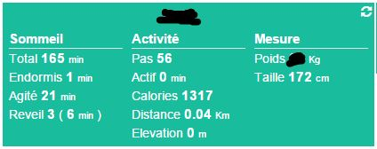

Configuração 
=============

 :

 
--------------------------------------------------------

> ****
>
> 
> 
> 

 :

 :

 :

> ****
>
> ". 
> 
> . 
> 
> 
> [ici](https:

> ****
>
> 
> 

[ici](https://dev.fitbit.com/fr), ensuite il vous faut vous connecter
 : "". 
:

-    : 

-   Descrição : 

-    : <https:>

-    : 

-    : <https:>

-   . : 

-    : 
    
    

-    : 

 :

-    : Sim

-    : 

-   o : 

-    : 

 :

-   

-   

-   

-   

-   

> ****
>
> 
> 

 :

 :

 :

Configuração 
-------------

 :

-    : 

-   Objeto pai : 

-    : 
    
    

-    :

    -   Historicizar : 

    -   Display : 

    -    : 
        

    -   Teste : 

    -    : 

 
------

 :

